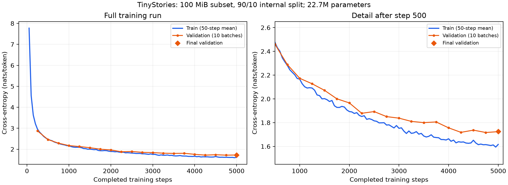

# TinyStories 基线训练记录

## 数据与配置

使用 TinyStoriesV2-GPT4 训练语料的约 100 MiB 前缀子集，共 127,994 个完整故事。
随机种子 42，按故事以 9:1 划分：训练 115,195 个故事、22,914,183 tokens；
内部验证 12,799 个故事、2,555,892 tokens。Tokenizer 在同一前缀子集上训练，
词表为 10,000，保留 `<|endoftext|>`。预处理输出通过内存映射读取。

| 配置 | 值 |
| --- | --- |
| 参数量 | 22,696,448 |
| 模型 | 4 层，d_model=512，16 heads，d_ff=1344，RoPE theta=10000 |
| 上下文 / batch size | 256 / 32 |
| 训练步数 / 总 tokens | 5,000 / 40,960,000 |
| 学习率 | 0.001 → 0.0001；预热 200 步，余弦衰减结束于第 5,000 步 |
| AdamW | betas=(0.9, 0.95)，eps=1e-8，weight_decay=0.1 |
| 梯度裁剪 | 整体 L2 范数上限 1.0 |
| 硬件 / 精度 | 单张 RTX 3090，float32 |
| 验证 | 每 250 步，10 个随机 batch，共 81,920 tokens |

完整配置见 [tinystories-training-config.json](./tinystories-training-config.json)，
训练命令见 [README](../README.md)。

## 实测结果

训练耗时 **585.17 秒（约 9 分 45 秒）**。首次记录的前 50 步平均训练损失为
**7.7732**，最后 50 步平均为 **1.6164**，全部损失记录有限。
第 250 步首次验证损失为 **2.8739**，第 5,000 步定期验证为 **1.7240**，
结束后另采样 10 个 batch 的最终验证为 **1.7257**，对应困惑度 **5.6167**。
这些指标来自上述子集的内部验证集。

指标原始值见 [CSV](./tinystories-training-metrics.csv) 与
[训练日志](./tinystories-training.txt)。CSV 的 elapsed_log_seconds 由已测得的日志间隔吞吐量重建；
验证行沿用此前训练日志时间，不单独测量验证耗时。完整训练总耗时包含最终验证和保存。

## Checkpoint 与本次修正

最终 checkpoint 为 `checkpoints/tinystories-baseline/checkpoint_final.pt`，保存模型、
AdamW 状态和 iteration=5000。恢复后只追加一步训练，得到 iteration=5001，
所有优化器步数同步到 5001，参数发生更新，模型及一、二阶矩均保持有限。
该恢复检查不计入基线的 40,960,000 tokens；记录见
[恢复日志](./tinystories-resume-validation.txt) 和 [状态核对](./tinystories-results-verification.txt)。

训练入口此前允许从 iteration=10 的 checkpoint 恢复，却把 max_steps 设为 4，
导致未更新参数就把新 checkpoint 的 iteration 写为 4，并打印负数处理量。
现已在加载后检查总步数上限。目标步数小于、等于、大于已完成步数的三种情况均通过验证，
见 [恢复边界记录](./train-resume-boundary-review.txt)。

整套官方测试结果为 **47 passed, 1 xfailed**，见
[测试日志](./pytest-required-final.txt)。预期失败项是整段编码内存测试。
## 文本生成

使用基线 checkpoint、temperature=0.8、top_p=0.9 和 192 个新增 token 的上限，
在 CPU 上对两个 prompt 续写，分别生成 138 和 97 个新 token，均遇到结束标记停止。
300-token 长 prompt 与零新增 token 的情况通过检查；同一 CPU 设备及种子的输出可复现。
示例与原始记录见 [generation-examples.md](./generation-examples.md)。

本次还修正了 top-p 累计概率相减造成的阈值舍入问题，并确保 top_p=1 保留完整分布。
采样及控制流程检查见 [generation-validation.txt](./generation-validation.txt)。
最终一页个人实验总结应由学生结合自己的理解与调试经历撰写。
